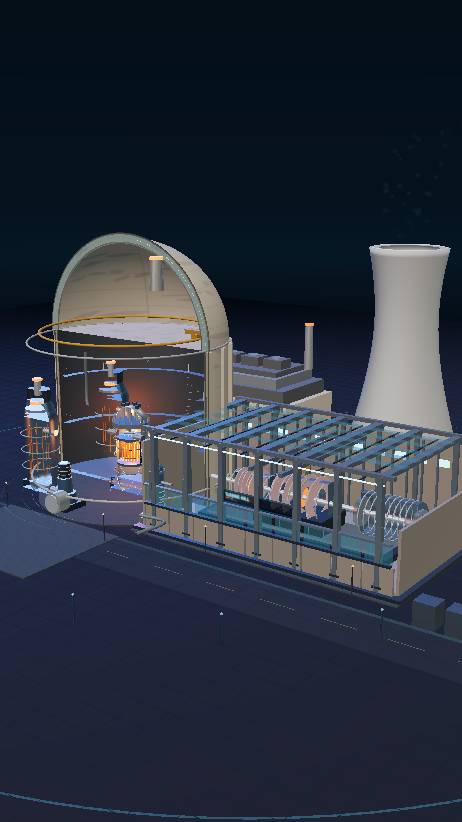
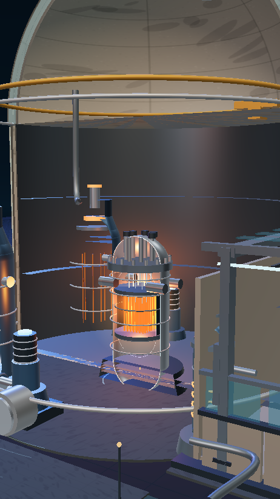

# Nuclear Reactor 3D Simulator

压水堆（PWR）核电站三维科普概念模型 · Web 3D + Android App



> **重要声明**
>
> 本项目是面向科普展示与交互设计的三维概念模型，**不是**真实核设施的施工图、燃料装载设计、运行控制系统或安全分析工具。模型中的几何尺寸、参数、温度、功率与动画均为示意，不得用于工程、培训或任何实际核设施用途。

## 项目亮点

- **完整厂区场景**：安全壳、反应堆压力容器、概念堆芯、蒸汽发生器、稳压器、主冷却泵、汽轮机房、汽轮机、发电机、冷却塔、辅助厂房与室外管线，全部由 Three.js 程序化几何体构建。
- **整体剖切**：沿 Z 轴对壳体做实时裁切，露出堆芯、U 形传热管束与压力容器内部；剖切深度可调，剖切边缘带发光截面提示。
- **分层拆解**：结构、核岛、一回路、二回路、冷却系统五层独立显隐，并可一键分层展开。
- **部件识别**：点击任意设备自动高亮、显示中英文名称、功能说明与示意参数，并支持聚焦、隐藏与上下切换。
- **多视角与自动旋转**：全景、反应堆岛、汽轮机组、冷却系统、俯瞰布局五个预设视角，OrbitControls 支持旋转/缩放/平移。
- **科技工业风 UI**：深蓝玻璃面板、青色信息光、橙色热量提示、双语结构树、参数面板、标注引线、全屏与重置。
- **移动端适配**：触摸旋转、双指缩放、双指平移，横竖屏自适应，抽屉式面板，安全区域适配，自动降低低性能设备渲染开销。
- **离线可运行**：全部字体、几何体、材质与逻辑打包在本地，无外部 CDN 依赖。
- **Capacitor Android 工程**：可直接用 Android Studio 打开；提供 Debug/Release Gradle 配置、沉浸式全屏、自适应图标和 APK 构建 workflow。



## 技术栈

| 层 | 技术 |
| --- | --- |
| 3D | Three.js r170、WebGL2、OrbitControls、RoomEnvironment、UnrealBloomPass |
| Web | Vite 5、原生 ES Modules、HTML5、CSS3 |
| 动效 | GSAP 3 |
| 原生壳 | Capacitor 6（Android） |
| 构建 | Gradle 8.2.1 / Android Gradle Plugin 8.2.1 / JDK 17 / compileSdk 34 |

## 快速开始（Web）

环境要求：Node.js ≥ 18（推荐 20 LTS）。

```bash
npm install
npm run dev          # http://localhost:5173
npm run build        # 生成 dist/
npm run preview      # 预览生产构建
```

首次安装如果访问 npm 官方源较慢，可临时使用镜像：

```bash
npm install --registry=https://registry.npmmirror.com
```

## 操作说明

| 操作 | 桌面端 | 移动端 |
| --- | --- | --- |
| 旋转 | 鼠标左键拖动 | 单指拖动 |
| 缩放 | 滚轮 | 双指捏合 |
| 平移 | 鼠标右键拖动 | 双指拖动 |
| 识别部件 | 单击模型 / 结构树 / 标注 | 轻触 |
| 聚焦 | 双击部件或点击“聚焦部件” | 点击“聚焦部件” |
| 剖切 | 底部“剖切”模式 + 深度滑杆 | 底部“剖切”模式 |
| 全屏 | 顶栏全屏按钮 / `F` | 顶栏全屏按钮（原生端默认沉浸式） |

快捷键：`R` 自动旋转、`L` 标注、`F` 全屏、`0` 重置、`1–5` 预设视角、`Esc` 取消选择。

> 剖切与分层模式会自动隐藏长距离工艺管线，避免遮挡设备本体；切回实体/透视模式后恢复显示。

## 目录结构

```text
.
├── index.html                 # 页面骨架与 UI
├── src/
│   ├── main.js                # Three.js 场景、交互、相机动画、UI 逻辑
│   ├── style.css              # 深色工业科技风 UI / 响应式适配
│   ├── data/parts.js          # 11 个部件、5 个层级、5 个预设视角的数据
│   ├── scene/PlantFactory.js  # 程序化核电站几何、材质、剖切、粒子与动画
│   └── assets/fonts/          # Rajdhani + Noto Sans SC 子集（本地离线）
├── docs/                      # 预览图
├── android/                   # Capacitor Android 工程（可直接用 Android Studio 打开）
├── release/                   # 已构建的 APK（构建后生成）
├── .github/workflows/         # GitHub Actions APK 构建
├── capacitor.config.json
└── vite.config.js
```

## Android 构建

详细步骤见 **[ANDROID_BUILD.md](ANDROID_BUILD.md)**。最短路径：

```bash
npm install
npm run cap:sync           # 构建 Web + 同步到 android/
cd android
./gradlew assembleDebug    # 输出 app/build/outputs/apk/debug/app-debug.apk
```

用 Android Studio 打开 `android/` 目录即可运行；项目已包含同步后的 Web 资源，因此即使暂不执行 `cap:sync` 也能直接打开预览。

### Release 签名

1. 生成 keystore：
   ```bash
   keytool -genkeypair -v -keystore android/nuclear-release.jks -alias nuclear \
     -keyalg RSA -keysize 2048 -validity 10000
   ```
2. 复制 `android/keystore.properties.example` 为 `android/keystore.properties`，填写密码。
3. 构建：
   ```bash
   cd android && ./gradlew assembleRelease
   ```

`keystore.properties` 与 `*.jks` 已被 `.gitignore` 排除。未配置签名时，Release 任务会产出 `app-release-unsigned.apk`，供后续签名使用。

### 已提供 APK

本项目已通过 GitHub Actions 的 Android 构建流水线（run `41666145019`）实际构建出 APK：

| 文件 | 大小 | SHA-256 | 说明 |
| --- | --- | --- | --- |
| [nuclear-reactor-3d-debug.apk](release/nuclear-reactor-3d-debug.apk) | 4.4 MB | `62a7858965cecbe7ca8e25410c70fd55e2615598fe04d1c710a95da3a9485656` | 已用 debug key 签名，可直接安装 |
| [nuclear-reactor-3d-release-unsigned.apk](release/nuclear-reactor-3d-release-unsigned.apk) | 3.5 MB | `2e4c3e5b0007297b800b3abce5a6c388f275c47eddaa40230803df55a4118882` | Release 未签名包，使用自己的 keystore 签名后分发 |

GitHub Releases 页面同样提供下载：<https://github.com/ymqzhy999/prw/releases/tag/v1.0.0>

> Release 未签名包不能直接安装。签名命令示例：
>
> ```bash
> apksigner sign --ks android/nuclear-release.jks >   --ks-key-alias nuclear >   --out release/nuclear-reactor-3d-release.apk >   release/nuclear-reactor-3d-release-unsigned.apk
> ```

也可通过 GitHub Actions 手动触发 **Build Android APKs** workflow，重新构建并下载 artifact。

**安装要求**：Android 5.1（API 22）及以上，建议 Android 9+ 与支持 WebGL 2.0 的 GPU。

## 性能说明

- 桌面端启用 2048 阴影贴图与 UnrealBloom；移动端自动关闭阴影/后期，降低像素比与粒子数。
- 帧率连续低于 30 FPS 时自动降低渲染分辨率（只触发一次）。
- 全部材质为程序化 PBR，无外部贴图请求；字体本地打包。
- 若在低端设备上仍需更流畅，可在 `src/main.js` 的 `lowPower` 判定中按需调整，或减少 `PlantFactory` 中的细节段数。

## 交互与数据说明

`src/data/parts.js` 是修改部件名称、描述、规格、热工状态、标注点与聚焦相机的单一入口。新增部件时：

1. 在 `PARTS` 中添加数据；
2. 在 `PART_ORDER` 与 `LAYERS` 中登记；
3. 在 `PlantFactory` 中新增 `buildPart('yourId', ...)`；
4. 在 `LABEL_OFFSETS`（main.js）中设置标注引线偏移。

## 浏览器支持

- Chrome / Edge / Firefox / Safari 最新两个大版本；
- 需要 WebGL 2.0 与硬件加速；
- 不支持 WebGL 时显示友好的降级提示。

## 许可

代码以 [MIT License](LICENSE) 发布。模型、文案与视觉设计仅用于学习、演示与非商业科普场景；不得用于任何实际核设施工程或运行用途。
